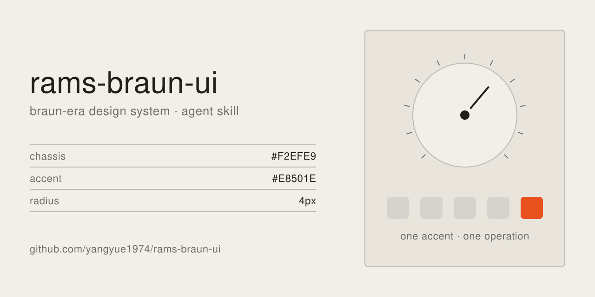

<picture>
  <source media="(prefers-color-scheme: dark)" srcset="docs/cover-dark.svg">
  
</picture>

# rams-braun-ui

**A Braun-era Dieter Rams design system as an Agent Skill** — for Claude, Claude Code, and any agent that speaks the SKILL.md standard.

Rams' ten principles are a verdict, not a recipe. This skill is the recipe: every rule below is reverse-engineered from Braun hardware (SK4, TP1, ET66, T3, TG60, regie 510) and Vitsoe 606, quantified, and made enforceable — so an AI agent can produce UI that reads as *Braun*, not as "generic minimal".

**→ [Live specimen](https://yangyue1974.github.io/rams-braun-ui/)** — a page built entirely from these tokens.

## What's inside

```
rams-braun-ui/
├── SKILL.md                     # build order + hard rules
├── references/
│   ├── tokens.md                # hex colors, type scale, spacing, radius, motion — with paste-ready CSS
│   ├── components.md            # buttons, toggles, sliders, forms, tables: exact specs
│   ├── anti-patterns.md         # the forbidden list (honesty & longevity, enforced as negatives)
│   └── checklist.md             # the ten principles as a final QA gate
└── docs/                        # the live specimen page (GitHub Pages)
```

## The core rules, in one breath

Warm-neutral chassis (never pure black or white) covering ≥95% of the surface · exactly **one accent color per view, bound to the single primary operation** · all-lowercase UI labels · functional grouping with a 2–3× zone-gap ratio · one global 4px radius · matte, flat, mechanical · every control displays its state at rest.

| | |
|---|---|
| neutral surface area | ≥ 95% |
| accent hues per view | 1, on the primary operation |
| chroma budget | ≤ 5% of pixels |
| ui label case | lowercase |
| gap inside a zone | 8–12px |
| gap between zones | 24–32px (2–3×) |
| corner radius | 4px, global |
| font sizes per screen | ≤ 3 |
| font weights | 400 / 500 |
| motion | 120–180ms ease-out |
| shadow at rest | none |

## Install

**Claude Code** — drop the folder at `~/.claude/skills/rams-braun-ui/` (personal) or `.claude/skills/rams-braun-ui/` (project):

```bash
git clone https://github.com/yangyue1974/rams-braun-ui.git ~/.claude/skills/rams-braun-ui
```

**Claude.ai / Claude Design** — Settings → Capabilities → enable code execution, then Customize → Skills → "+" → upload this folder as a ZIP.

## Use

Say `use the rams-braun-ui skill to build …`, or just ask for "Rams style" / "Braun style" / "拉姆斯风格" — the skill triggers on those.

Tip: on first runs, don't add your own style adjectives ("minimal", "premium"…). Let the skill drive alone, so you can attribute the output to the tokens — then tighten the tokens, not the prompt.

## 中文简介

这不是把拉姆斯十大原则复述一遍——十大原则是验收标准，不是生成规则。这个 Skill 把 Braun 产品（1955–1995）的设计语言逆向成了可执行的硬规格：色板 hex、字号表、间距比例、圆角、禁令清单，最后才让十大原则回到它该在的位置——QA 层。装进 Claude / Claude Code，说一句"用拉姆斯风格做个页面"即可。

[在线样例页面](https://yangyue1974.github.io/rams-braun-ui/) 本身就是这套 token 的输出。

## Provenance & license

Hex values and measurements are derived from photographic reference of Braun products; they are internally consistent approximations, not official Braun specifications. This project is an homage to the work of Dieter Rams and the Braun design department, unaffiliated with Braun GmbH or Vitsoe. MIT licensed — see [LICENSE](LICENSE).
